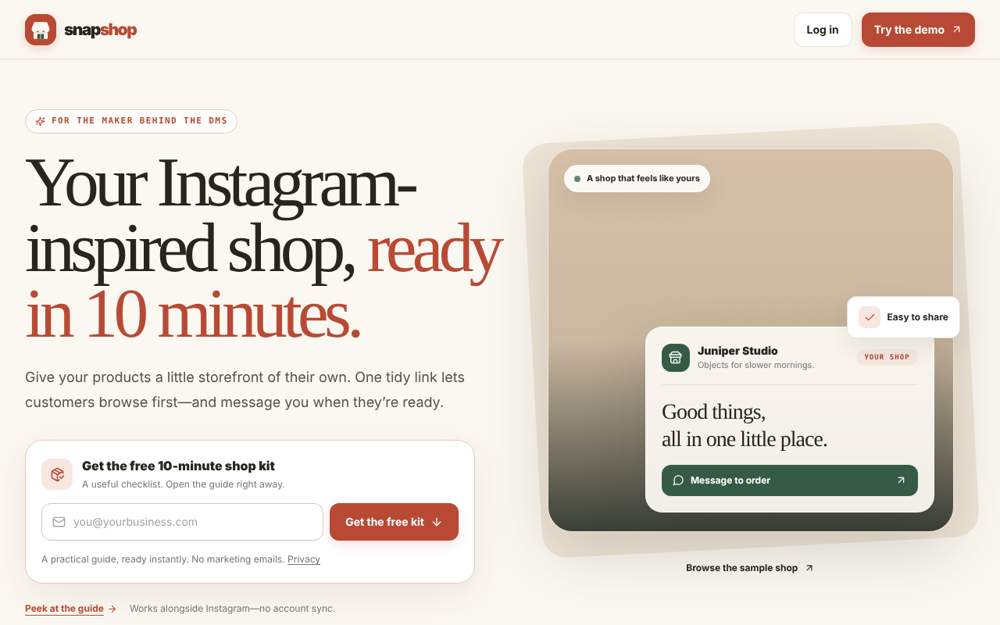
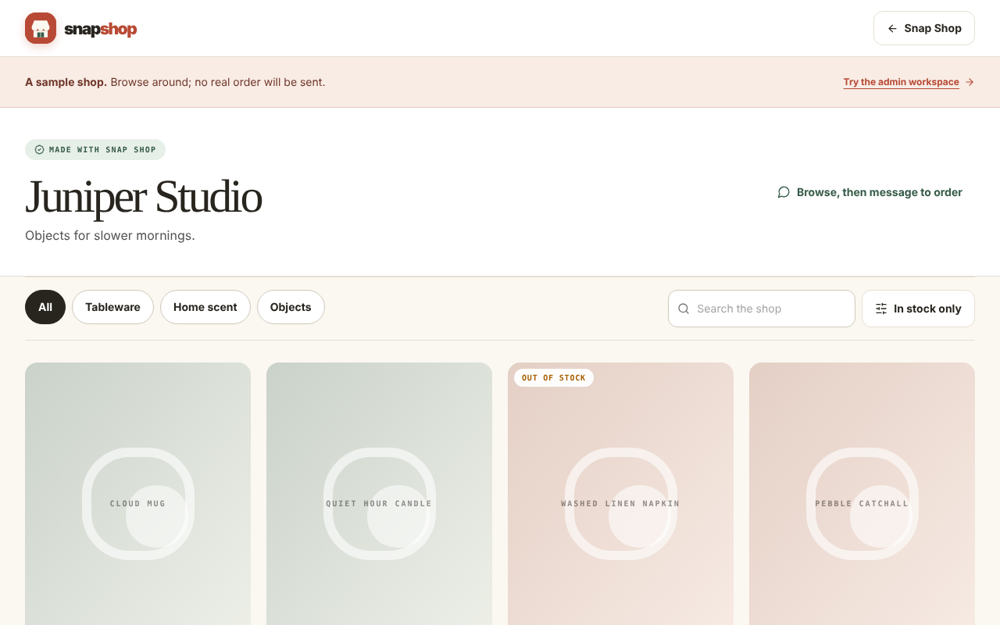
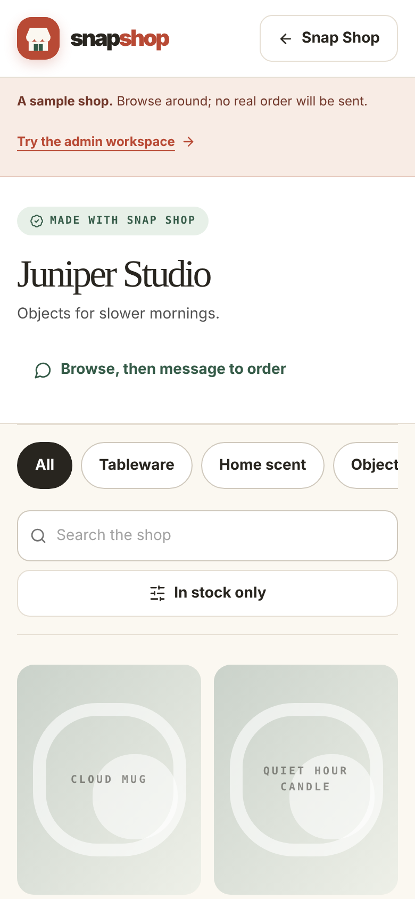
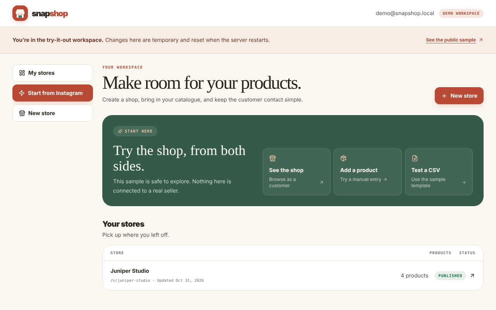
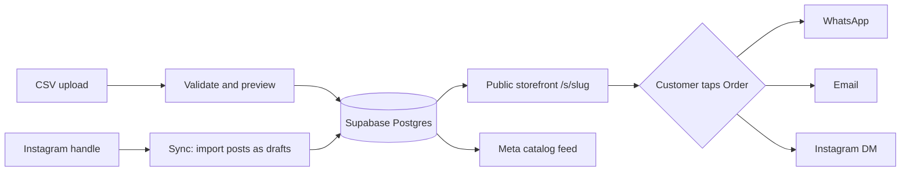

<div align="center">


# Snap Shop

**Turn a product list or an Instagram handle into a mobile-ready storefront with one shareable link.**
Customers browse, then message you to order. No cart. No payment processor.

[](https://nextjs.org)
[](https://www.typescriptlang.org)
[](https://supabase.com)
[](https://tailwindcss.com)
[](#️-development)
[](LICENSE)

[Quick start](#-quick-start) · [Features](#-features) · [Connect Supabase](docs/SETUP.md) · [How it works](#-how-it-works) · [Roadmap](docs/ROADMAP.md)

<br />



</div>

<br />

## ✨ Features

| | |
| --- | --- |
| 🛍️ **Storefronts** | Server-rendered pages at `/s/<slug>` with search, category chips and an in-stock filter. Product pages have image galleries, SEO metadata, JSON-LD, a sitemap and robots rules. |
| 💬 **Order by message** | A prefilled message opens WhatsApp first, then email, then Instagram. Out-of-stock items become "Ask about restock". |
| 🙋 **Self-serve signup** | Anyone can sign in with a magic link and create their own shop. No operator needed. One shop per user, enforced in the database. |
| 🧰 **Admin workspace** | Store settings, a product editor (5 images, drag or keyboard ordering, bulk actions) and publish or unpublish. Operators see every store; owners see only their own. |
| 📥 **CSV import and export** | Upload, validate, preview, then commit in one atomic transaction. Re-importing updates by SKU or title instead of duplicating. Exports round-trip. |
| 🖼️ **Secure image pipeline** | Server-side fetch with SSRF blocking, EXIF stripping, resize to 1200px and WebP conversion. |
| 📸 **Instagram and Facebook sync** | Import IG posts as draft products, post products to a Page or Instagram, and publish a Meta catalog feed. Tokens are AES-256-GCM encrypted. *(Optional)* |
| 🔐 **Locked down by default** | Row-level security on every table, origin and CSRF checks, rate limits, a honeypot lead form, and no service-role key in client code. |
| 🧪 **Demo mode** | Runs with no backend at all, using sample data. |

<table>
  <tr>
    <td width="62%"></td>
    <td width="38%"></td>
  </tr>
  <tr>
    <td align="center"><sub>Public storefront (desktop)</sub></td>
    <td align="center"><sub>Mobile</sub></td>
  </tr>
</table>


<p align="center"><sub>Admin workspace with a guided first-run path</sub></p>

## 🚀 Quick start

Needs **Node 20+** and **pnpm 10** (`corepack enable`).

```bash
git clone https://github.com/herrmichaeldieivi/Snapshop.git
cd Snapshop
pnpm install
pnpm dev
```

Open <http://localhost:3000>. With no Supabase variables set, the app starts in **demo mode**.

| Route | What you get |
| --- | --- |
| `/` | Landing page |
| `/10-minute-shop` | Setup guide |
| `/demo` | Sample storefront (never sends a real order) |
| `/admin` | Admin with temporary sample data that resets on restart |

## 🔌 Connect Supabase

> Full walkthrough with troubleshooting: **[docs/SETUP.md](docs/SETUP.md)**

1. Create a [Supabase](https://supabase.com) project.
2. Apply the migrations in `supabase/migrations/` in order (`supabase db push`, or paste them into the SQL editor).
3. `cp .env.example .env.local` and fill in the URL, anon key and service-role key.
4. Allow `<your-site>/auth/callback` under Auth, then URL Configuration, then Redirect URLs.
5. Sign in once, then promote yourself to operator:

```sql
update public.profiles set is_operator = true
where id = (select id from auth.users where email = 'you@example.com');
```

### Environment variables

| Variable | Needed for | Notes |
| --- | --- | --- |
| `NEXT_PUBLIC_SUPABASE_URL` | Real backend | Project URL |
| `NEXT_PUBLIC_SUPABASE_ANON_KEY` | Real backend | Public anon key |
| `SUPABASE_SERVICE_ROLE_KEY` | Images and sync | **Server only. Never expose.** |
| `NEXT_PUBLIC_SITE_URL` | Production | Public `https://` origin for canonical URLs, sitemap and Meta image fetches |
| `TOKEN_ENCRYPTION_KEY` | Meta sync | `openssl rand -base64 32` |
| `META_APP_ID`, `META_APP_SECRET` | Live Meta sync | Without them the Sync tab runs in preview mode |
| `META_GRAPH_VERSION`, `META_LOGIN_CONFIG_ID`, `META_SCOPES`, `META_MOCK` | Optional | Meta tuning |
| `RESEND_API_KEY`, `SENTRY_DSN`, `RATE_LIMIT_STORE` | Optional | Reserved |

## 🧭 How it works



**Data layer.** One typed repository interface has two implementations: Supabase, and an in-memory demo. The app picks one at startup, so the same UI runs both ways. Details are in [docs/ARCHITECTURE.md](docs/ARCHITECTURE.md).

**Security model**

- Anonymous visitors can only read *published* stores and their products.
- Owners can read and write only their own store. Operators can access all stores.
- Ownership, status and `is_operator` can't be changed through the API.
- Image URLs are fetched server-side only, blocking localhost, private ranges, link-local and metadata IPs.
- Meta tokens live in tables with no client access.

## 🗂️ Project layout

```text
app/                  Routes: public storefront, admin, API handlers
components/           UI and admin forms
src/lib/              Validation, CSV, image pipeline, security, social sync
src/lib/repository/   Supabase and demo data layers behind one interface
supabase/migrations/  Schema, RLS, storage buckets, RPCs
supabase/tests/       pgTAP row-level-security tests
docs/                 Setup, architecture, roadmap
__tests__/            Vitest suites
```

## 🛠️ Development

```bash
pnpm dev           # dev server
pnpm check         # typecheck
pnpm lint          # eslint
pnpm test          # 95 tests: CSV, slugs, order links, SSRF, RLS rules, Meta sync
pnpm build         # production build
supabase test db   # pgTAP RLS tests (needs the Supabase CLI)
```

## ☁️ Deploy

Works on Vercel or any Node host. Set the env vars above, set `NEXT_PUBLIC_SITE_URL` to your real https origin, and add `/auth/callback` to Supabase redirect URLs.

```bash
docker build -t snapshop .
docker run -p 3000:3000 --env-file .env.local snapshop
```

## ⚠️ Known limitations

- Self-serve signup creates one shop per user. Multiple shops per account are operator-only. "Start from Instagram" is also operator-only.
- Instagram posting is untested against live Meta. Accounts outside your app's roles need Meta App Review and Business Verification.
- Privacy and Terms pages are placeholders. Replace them before accepting real customers.

See the [roadmap](docs/ROADMAP.md) for what's next.

## 📄 License

[MIT](LICENSE) © 2026 Muafaq Belaly
